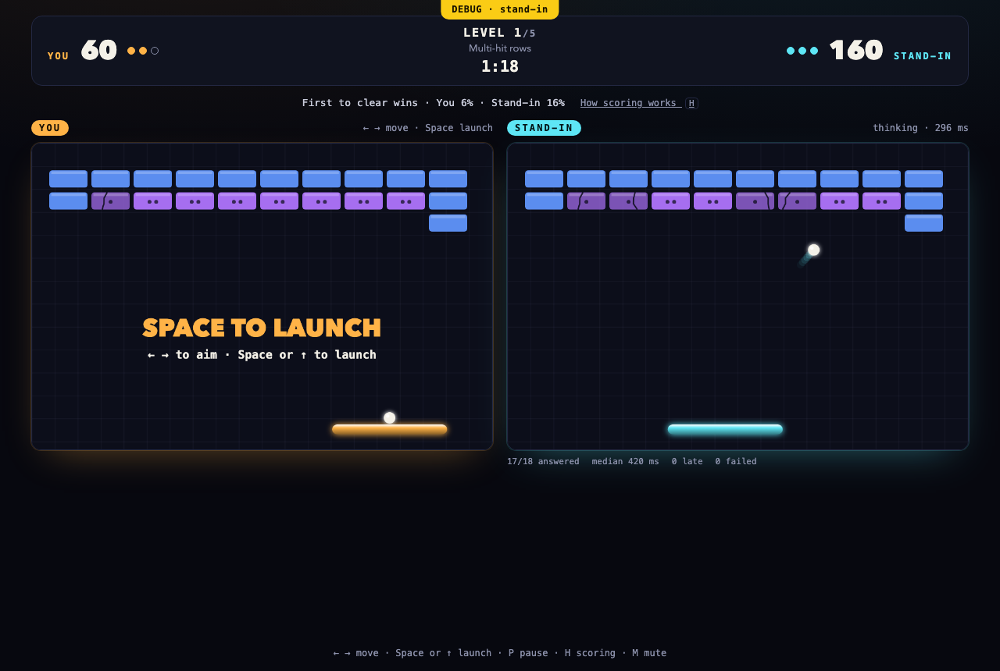

<div align="center">


<h1>Brick Arena</h1>

<p><strong>Breakout against TypeSafe's Jev, on one seed, where the faster clear wins.</strong></p>

<p>You and Jev each play a board of the same five levels, side by side. Jev picks where<br />
each catch sends the ball, asked about the board as it will stand when its answer lands.</p>

<p>
<a href="https://github.com/mgballou/brick-arena/actions/workflows/ci.yml"></a>

</p>

</div>

<br />



Level 1, *Multi-hit rows*, in debug mode: the right-hand board is the local stand-in, not Jev,
and the yellow banner says so. Live Jev draws the same screen with its name on that board.

**Play it: `<hosted URL — filled in after the deploy>`**

The game is live Jev or nothing. Live Jev needs a TypeSafe key; with no key, or when Jev can't
answer, the page says the game is down and shows no board. The hosted page holds the key as a
server secret, so you need none there. [docs/deploy.md](docs/deploy.md) sets it up.

## How a match works

- Left and Right move your paddle; Space or Up serves; P pauses; H shows how scoring works; M mutes.
- Each level runs 90 seconds with three balls a side. The first to clear it takes it; otherwise the larger share cleared does. A level scores 10 per percent cleared plus 10 per second left at a clear, so the score leader is the one winning. A lost ball costs only the serve. The higher total after level 5 wins. [docs/scoring.md](docs/scoring.md) defines it, and Jev's prompt states it.
- The page checks Jev before it shows a board. When the forwarder says Jev can't answer (no key; an auth, credit or rate refusal; a TypeSafe error or timeout; a stand-in outside debug mode; or the day's cap spent), the page says the game is down and shows no board, then or mid-match. The reason goes to the server log only. Three timeouts in a row, or losing the game server, pause the match with a Retry, and it never goes on without Jev.
- Who answered comes from the reply, never the URL: a reply marked `answered_by: "stand-in"` is the stand-in, and one without the mark is live Jev. The proxy and the browser both refuse the stand-in outside debug mode.

## Run it locally

For developers. You need your own TypeSafe key. The repo pins no Node or pnpm version in `package.json` or `.nvmrc`; CI runs Node 24 and pnpm 11, so use those.

```sh
git clone https://github.com/mgballou/brick-arena.git
cd brick-arena
pnpm install
printf '%s\n' '<your TypeSafe key>' > ~/.jev-key
chmod 600 ~/.jev-key
pnpm dev
```

Then open <http://localhost:5173>. The dev server reads `~/.jev-key` once, when it starts, and forwards Jev's calls itself, so the browser never sees the key. The title screen says *Jev is online* when the key works.

## Debug mode

**Not a real game.** Debug mode is the one way to run the page without Jev: a local stand-in answers in Jev's place. `pnpm jev:stub` runs it; it aims every catch at the densest bricks (`clearFast` in `packages/jev/src/stand-in.ts`) and marks every reply `"answered_by": "stand-in"`. Start the page against it:

```sh
pnpm jev:stub &
printf 'dummy\n' > /tmp/dummy-key
VITE_DEBUG=1 JEV_KEY_FILE=/tmp/dummy-key JEV_BASE_URL=http://127.0.0.1:18787 pnpm dev
```

The screen then shows a `DEBUG · stand-in` banner and names the right-hand board Stand-in, and the match record (`window.__arena.read()`) carries `debug` and `opponent`. Automated runs and Playwright use this mode. The endpoint overrides apply only with `JEV_KEY_FILE`, so the real key goes only to TypeSafe.

## The engine

The board is pure TypeScript; React only renders it. Players answer one categorical `Ask` at bounce cadence, and every answer carries `ms` without pausing simulation. `packages/engine/src/arena.ts` layers the game's rules over it (a narrower paddle, serves, lives, scoring, level results) without changing `step`, so recorded sessions still replay. The deterministic bot stays for the tooling below; players never see it.

```sh
pnpm test
pnpm session && pnpm compare
```

The session command writes newline-delimited telemetry to `docs/session.ndjson`; the comparison command reports completion ticks and reaction median/p95. Five levels force different decisions: multi-hit rows reward bounce planning; split walls make the reachable side depend on angle; a narrow gap trades patience for a high-value cluster; a regenerating perimeter makes neglected regions costly; and power-up hazards make accepting a drop a judgment call. The power-ups are `extra-ball` (more balls, harder tracking), `long-slow-paddle` (more reach, less speed), `piercing-ball` (less bounce control), `magnet-paddle` (safer but less lateral control), and `short-paddle` (bad when the board tempts a careless chase).

Every session record includes the seed, level, complete `Ask` (including the exact board state), decision, tick, and reaction time. That makes the state sequence replayable for a later ghost-mode comparison even though the two live boards diverge after their first different decision.

There are two comparison modes:

- **Race** compares outcomes on the same seed: completion time and bricks cleared, plus each player's own reaction-time distribution.
- **Ghost** replays one recorded player's exact decisions and asks a second `Player` the same `Ask` without applying its answer. It compares decisions, reports divergences with the faced state, and counts failed or timed-out ghost answers as missing rather than agreement.

`pnpm compare` prints both the race summary and the deterministic bot as a ghost for each recorded Human level. Pass another NDJSON session path to compare a different recording.

## Add a third player

Implement `Player` in `packages/engine/src/index.ts` (or an adapter file): provide a `name` and `decide(ask: Ask): Promise<{ decision: Decision; ms: number }>`; return a categorical `Decision`, never paddle arithmetic. The board accepts it without knowing whether it is human, deterministic, or network-backed.

## Seat a real Jev

`packages/jev` holds a `Player` backed by TypeSafe's Jev, called over plain `fetch` at `POST {base}/v1/systemone`. It reads the TypeSafe key from `~/.jev-key` once, at construction, and sends it as `Authorization: Bearer`. The key never enters the environment or a recording.

```sh
pnpm smoke   # one live call: status, latency, the choice Jev made
pnpm jev     # race Jev against the deterministic bot
```

- Endpoint: `https://api.typesafe.ai`, model `jev-latest`. A `JEV_BASE_URL=` or `JEV_MODEL=` line in the key file overrides either; so do `--base-url` and `--model`.
- Key file: a bare token, or a `JEV_API_KEY=` line. `--key-file` reads another.
- The Vercel AI Gateway route (`https://ai-gateway.vercel.sh/typesafe`, `typesafe-ai/jev`) wants a Gateway key, not a TypeSafe one, and answers 401 to it.

That races Jev against the deterministic bot on level 0 (`--level`, `--seed`, `--max-ticks`, `--deadline` to change), writes every call and response to `docs/jev-calls.ndjson`, and every decision to `docs/jev-race.ndjson`.

Each `Ask` becomes one `choice` question keyed `decision`, and the answer must be one of the offered keys or the call fails:

- `target`: `landing`, `aim`, `angle-left`, `angle-right`, the four `x` values `askForDecision` offers, in that order: a dead-center catch, a catch that sends the ball into the densest bricks it can reach, and catches that send it off at 45 degrees. Every question opens with the objective and scoring from `docs/scoring.md`.
- `chase`: each falling power-up by id, plus `none`.
- `track`: each ball by id.

A call never holds the board. Its wall-clock time becomes game time at 60 ticks a second: the board keeps stepping on the last target, and the answer lands `ceil(ms / 16.7)` ticks after its ask. An 800 ms answer lands 48 ticks late and the player misses the next ask. A call with no answer by `--deadline` (1000 ms) is a timeout, and a failed call is an error; neither applies anything. The summary prints each of these: applied, timeouts, errors, asks missed while waiting, ticks spent waiting, and ms median, p95 and max.

In the web game Jev is asked about the board as it will stand when its answer lands (`boardAhead` in `arena.ts`, led by the match's median answer time), so a slow answer still fits the ball. `pnpm fair` measures what that buys: both boards on one seed, the stand-in's rule answering after `--ms` (default 728, the one live Jev call), against a player on the keys who reacts in `--react` ms. `pnpm objective` compares clear times for the stand-in's old rule (always `landing`) and its new one (always `aim`) over many seeds.

`docs/jev-calls.synthetic.ndjson` is **synthetic**: hand-written from the documented response shape by `pnpm jev --write-synthetic`, not captured from a call. Its answers follow the bot's rule, it holds one made-up failure, and it carries no times. It plays seed 20260962 on level 1, the first seed where that rule clears a level and meets all three questions. The tests replay it, and so can you:

```sh
pnpm jev --replay docs/jev-calls.synthetic.ndjson --seed 20260962 --level 1
```

`--replay` also takes a captured `docs/jev-calls.ndjson`, landing each answer as late as it was recorded.

## Reference read

Before building, I read [jakesgordon/javascript-breakout](https://github.com/jakesgordon/javascript-breakout), the Breakout entry linked from [open-source-games](https://github.com/bobeff/open-source-games). I took its clear update/draw split, row-based level data, and rectangle model. I changed the architecture where this brief requires it: pure state transitions, fixed-step tests, bounce-cadenced decisions, and non-blocking player answers.
