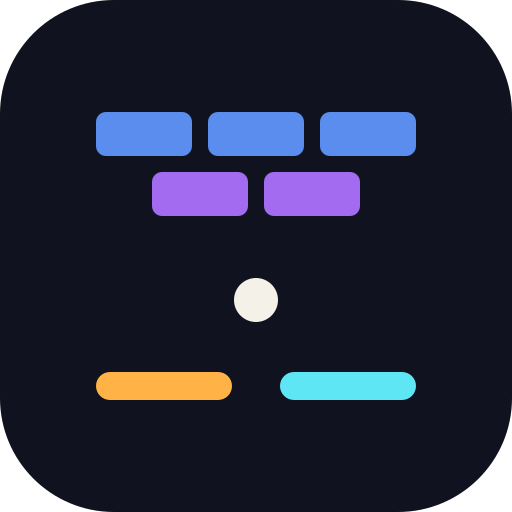
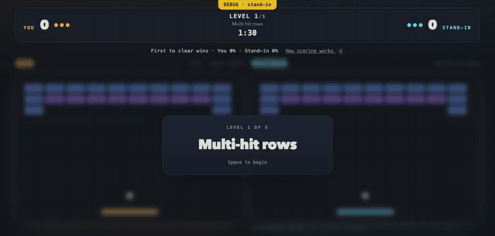
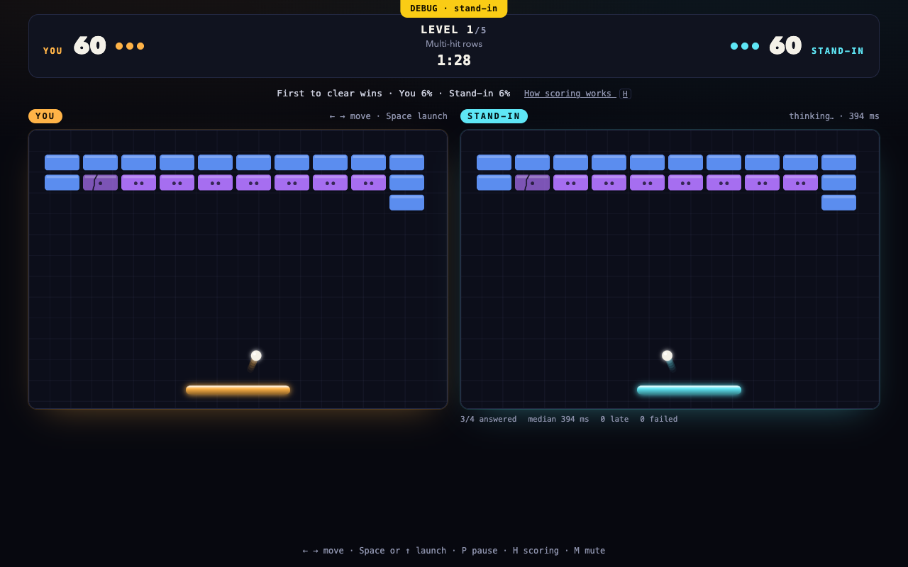

<div align="center">



<h1>Brick Arena</h1>

<p><strong>An experiment: put a fast, pick-from-a-list model in a live game seat, and see how it plays when every answer lands late.</strong></p>

<p>Two boards, one level, one seed. You play the left on the arrow keys.<br />
TypeSafe's Jev plays the right, one closed question at a time, over the network.</p>

<p>

</p>

</div>

<br />



Level 1: a script on the arrow keys plays the left board, and the right is the local stand-in, not Jev, answering at live Jev's measured 728 ms ([MP4](docs/screens/2026-09-27/level-1.mp4)).



Level 1, *Multi-hit rows*, in debug mode: the right-hand board is the local stand-in, not Jev,
and the banner says so. Against live Jev the same screen names Jev on that board.

**Status: deploy-ready, not live.** No hosted copy runs, and the Render, Supabase and
PostHog accounts it needs are not yet made. You can run it on your own machine
([Run it locally](#run-it-locally)), and [docs/deploy.md](docs/deploy.md) and
[docs/go-live.md](docs/go-live.md) say how to deploy it.

## The experiment

Jev is a System 1 type model: small and text-only, served by TypeSafe's API at
`/v1/systemone`. It does not write prose; it picks one option from a list you hand it, and
it picks fast. It is pitched at the narrow question inside a loop:
which tool next, is this spam, does this need a person.

Brick Arena gives it a harder job. Can a model that only picks from a list play a real-time
game against a person, when the board keeps moving while it thinks? And told what winning
takes, does it pick the safe move or the one that wins?

## How the arena asks it

- **Same level, same ball.** Both boards start from one seed on one of five levels, and a
  countdown launches both first balls at once. Each level runs 90 seconds with three balls
  a side.
- **Winning is clearing fast.** The first board to break every breakable brick takes the
  level. If nobody clears, the larger share cleared takes it. A level scores 10 per percent
  cleared plus 10 per second left at a clear, and the higher total after five levels wins
  ([docs/scoring.md](docs/scoring.md)).
- **What Jev is sent.** The whole board as JSON (paddle, balls, falling power-ups, every
  live brick), the rules and scoring above, and one question with a closed list of answers:
  - `target`: where to catch the ball, and so where it goes next. `landing` catches it
    dead center, the safe catch. `aim` catches it off center to send it into the densest
    bricks it can reach. `angle-left` and `angle-right` send it off at 45 degrees.
  - `chase`: which falling power-up to go for, each named with what it does to the pace
    of a clear, or `none`.
  - `track`: which ball to play, when more than one is in the air.
- **What Jev decides.** One key from that list, and nothing else. An answer outside the list
  fails the call. The paddle acts on the key; it never takes a number from Jev.
- **The board never waits.** The page asks Jev on a steady beat and after every bounce, one
  call at a time. Its board keeps playing Jev's last answer, and a new one lands as many ticks
  late as the call took, at 60 ticks a second. A call with no answer in two seconds is late
  and changes nothing; three late in a row pause the match until Jev is back. To make up for
  the lag, the page asks about the board as it will stand when the answer lands, judged by
  Jev's median answer time so far.
- **No live Jev, no game.** When Jev can't answer, the page says the game is down and shows
  no board. A local stand-in can sit in Jev's seat only in debug mode, which says so on
  screen and in the match record.

As you play, Jev's board shows each choice as it lands, how long it took, the median, and a
count of late and failed calls.

## What the experiment found

One call to live Jev is measured. A match against live Jev on 25 September left no record
([docs/scoring.md](docs/scoring.md#keeping-the-ball)). Every other number comes from the
stand-in: a scripted rule in Jev's seat, sent through Jev's exact wire, answering at Jev's
measured speed. Those
numbers show what the arena rewards and what lag costs. They do not show what Jev does.

**Jev answers in time.** One call through the `smoke` command, 22 September: HTTP 200 in
728 ms, well inside the game's two seconds, with 1,502 tokens in and 45 out. It chose
`landing`, the safe catch. That call came before the prompt stated the objective, so it says
nothing about how Jev plays now. At 728 ms an answer lands 44 ticks after its question.

**Lag cost balls and asking ahead won most of them back on the old engine; on today's engine no board loses a ball.** `npm run fair`:
seed 20260919, five levels, the stand-in answering in 728 ms against a scripted player on the
keys who reacts in 200 ms ([docs/where-it-is.md](docs/where-it-is.md)).

| Jev's board | Balls lost | Bricks broken | Balls lost, 9 October | Bricks broken, 9 October |
|---|---|---|---|---|
| Player on the keys, for scale | 0 | 48 | 0 | 85 |
| Asked about the board on screen | 15 | 24 | 0 | 89 |
| Asked about the board as it will stand (kept) | 4 | 39 | 0 | 86 |

The 24 September run predates that day's brick collision fix
([docs/brick-collisions.md](docs/brick-collisions.md)). Rerun on 9 October, no board loses a
ball and the board asked about the screen breaks the most bricks, so the case for asking
ahead holds only for the old engine.

**Aiming wins, and spends balls to do it.** `npm run objective`, 24 September: 50 seeds, five
levels each, answers at 728 ± 150 ms, then the two rules played head to head
([docs/scoring.md](docs/scoring.md)).

| Rule | Levels cleared | Balls lost | Levels won head to head |
|---|---|---|---|
| Always `landing` | 10 of 250 | 351 | 26 |
| Always `aim` | 78 of 250 | 461 | 214 (10 ties) |

**Keeping the ball first cut the aiming rule's lost balls from 461 to 63.** `npm run objective`,
26 September, after a live match on 25 September saw Jev lose all three balls on one level:
the prompt now says to keep the ball first, and the board Jev is sent shows where each ball
comes down and which power-ups it can reach without losing it. At 728 ± 150 ms the `aim` rule
then cleared 160 of 250 levels, up from 78, and ran out of balls on none
([docs/scoring.md](docs/scoring.md#keeping-the-ball)).

**The arena rewards the aimed catch over the safe one.** `npm run tunings`, 25 September, the
standard game: the stand-in as the game plays it, at 500, 728 and 1,000 ms, cleared 32 of 75
level runs. A scripted keys player who sees the board 200 ms late and only catches cleared
none of 25. Neither cleared level 2 (split walls) or level 4 (regenerating perimeter)
([docs/tunings.md](docs/tunings.md), which also holds two tunings to try behind `?tuning=`).

**A dead-center catch can trap the ball.** In the bare engine, a ball caught dead center goes
straight up and down one column for good. The arena sets a floor on the return angle, so
`landing` stays a real choice and not a trap
([docs/brick-collisions.md](docs/brick-collisions.md)).

## What it did not find out

The repo records no live match, and with no hosted copy none are being played. These stay
open:

- Which catch Jev picks once it knows the objective, and how often it takes `aim`.
- How its answer time spreads over a match: the median, the slow tail, how many calls run late.
- Whether it beats a person, and on which levels.
- What a call costs in tokens now that the prompt carries the objective and names each catch.

The server keeps a record of each match, with every Jev call in it, so a few played
matches against live Jev, locally or on a deployed copy, can answer these.

## Run it locally

You need Node 24 and your own TypeSafe key.

```sh
git clone https://github.com/mgballou/brick-arena.git
cd brick-arena
npm install
printf '%s\n' '<your TypeSafe key>' > ~/.jev-key
chmod 600 ~/.jev-key
npm run dev
```

Open <http://localhost:5173>. The dev server reads `~/.jev-key` once, when it starts, and
forwards Jev's calls itself, so the browser never sees the key. The title screen says
*Jev is online* when the key works. pnpm works too (`pnpm install`, `pnpm dev`) and installs
from the lockfile, as CI does.

Left and Right move your paddle. After a lost ball, Space or Up serves. P pauses, H shows how
scoring works, M mutes.

### Debug mode, without Jev

**Not a real match.** A local stand-in answers in Jev's place. It keeps the ball first and
aims every catch at the densest bricks (`clearFast` in `packages/jev/src/stand-in.ts`) and marks every reply
`"answered_by": "stand-in"`. No call leaves your machine.

```sh
npm run jev:stub &
until curl -s -o /dev/null --max-time 1 http://127.0.0.1:18787/; do sleep 0.2; done
printf 'dummy\n' > /tmp/dummy-key
VITE_DEBUG=1 JEV_KEY_FILE=/tmp/dummy-key JEV_BASE_URL=http://127.0.0.1:18787 npm run dev
```

The screen shows a `DEBUG · stand-in` banner and names the right-hand board Stand-in. Outside
debug mode, the forwarder and the page both refuse a stand-in's reply. Who answered comes from
the reply's mark, never the URL.

## Deploying it

Nothing is deployed, and the accounts a deploy needs (Render, Supabase, PostHog) are not yet
made. The code is ready for them: [docs/deploy.md](docs/deploy.md) sets up the host, and
[docs/go-live.md](docs/go-live.md) lists every step in order, from the Render Blueprint to the
first match row in Supabase.

A deployed page holds the TypeSafe key as a server secret, so a player needs none, and a daily
cap on Jev calls keeps a bot from spending it. When Jev can't answer or the cap is spent, the
page says so and shows no board.

The server keeps a record of each match: every launch, lost ball and Jev call, with the board
Jev was sent, and both boards' clear over time. Only the admin reads them, with the server's
`ADMIN_SECRET`: `/matches.html` lists recent matches and opens each one's timeline, and
`npm run match` prints them with a tally of every choice Jev made. A deployed page reads
from Supabase when both `SUPABASE_URL` and `SUPABASE_SECRET_KEY` are set; otherwise it
reads the server's local match files. The secret key stays on the server. `SUPABASE_WRITES=1`
is also needed to save new live matches to Supabase.
[docs/deploy.md](docs/deploy.md#match-records) says where they live.

## The data a deployed copy collects

How each match plays, never who played it. The title screen says so in one line, with a link
to the [privacy page](privacy.html) and an **Opt out** beside it; Do Not Track counts as
opting out.

- **Player events**, sent to PostHog when the page is built with `VITE_POSTHOG=1`: matches,
  levels, lost balls, pauses and Jev's choices, with screen size and input type. PostHog's
  random anonymous id stays in the browser's local storage and is never identified.
- **The match record**, sent to the game server: every Jev call with the board it was sent,
  every launch and lost ball, both boards' clear over time and each level's result. The
  server keeps it as a file in `MATCHES_DIR`, and as rows in Supabase with
  `SUPABASE_WRITES=1`. Only the admin reads it, with the server's `ADMIN_SECRET`.
- **Never**: an IP address, a name, an account, a fingerprint or a screen recording. Debug
  play and stand-in matches reach neither PostHog nor Supabase.

[docs/specs/data-collection.md](docs/specs/data-collection.md) has the design, and
[docs/deploy.md](docs/deploy.md#match-records) says where each piece lives.

## How it is built

| Package | Holds |
|---|---|
| `packages/engine` | The board, in pure TypeScript: `step`, the five levels, and `askForDecision`, which turns a board into one closed question. `arena.ts` lays the match rules over it: paddle, serves, lives, scoring. |
| `packages/jev` | Jev's seat: the wire format and prompt (`wire.ts`), the one reader of the key (`key.ts`), the forwarder the browser calls (`proxy.ts`), the daily cap, and the stand-in. |
| `packages/web` | The React page. It draws both boards and reads the keys; it never holds the TypeSafe key. |
| `packages/server` | The hosted page's Node server: the built page, the same forwarder, and the match records (`record.ts`, `matches.ts`) behind the admin's password (`admin.ts`), with their rows in Supabase (`supabase.ts`, `rows.ts`). |
| `packages/cli` | The measuring tools below, and the admin's tools that [docs/deploy.md](docs/deploy.md) runs: `match`, `export`, `weekly` and `smoke:site`. |

The engine is deterministic: the same seed and the same answers give the same board, tick for
tick. So a recorded session replays exactly, and each number above reruns from its command.

`npm test` runs the Vitest suite. It pins the ball's collisions with bricks, replays the
recorded sessions in `docs/`, checks the forwarder and the cap, and builds the page to fail
if the bundle holds a key or names a TypeSafe host. No test calls live Jev. The Jev tests
replay `docs/jev-calls.synthetic.ndjson`, which is **synthetic**: written by hand from the
documented reply shape, not captured from a call.

```sh
npm test            # the engine, Jev, server and page tests; none calls live Jev or Supabase
npm run build       # typecheck (tsc -b), then the production build in dist/
npx --yes knip      # unused files, exports and dependencies; it should report nothing
```

On every pull request, CI installs from the lockfile with the pnpm that
`packageManager` pins, on the Node in `.nvmrc`, then runs three jobs: the tests and `tsc -b`,
the browser specs in Chromium (`pnpm e2e`), and the Supabase path on Postgres and PostgREST
(`pnpm test:db`). Dependabot proposes updates to the pins once a week.

| Command | What it does |
|---|---|
| `npm run smoke` | One live call to Jev: status, time, the choice it made. |
| `npm run jev` | Races live Jev against the engine's scripted bot and writes every call to `docs/jev-calls.ndjson`. `--replay` plays a recording back. |
| `npm run fair` | Jev's board at a set answer time against a player on the keys. |
| `npm run objective` | The `landing` and `aim` rules head to head over many seeds. |
| `npm run tunings` | Clear times for each tuning. |
| `npm run session`, `npm run compare` | Record a session to `docs/session.ndjson`, then compare two players on it, as a race or with one replaying the other's exact states. |

The board's split of update and draw, its rows of level data and its rectangles follow
[jakesgordon/javascript-breakout](https://github.com/jakesgordon/javascript-breakout).
